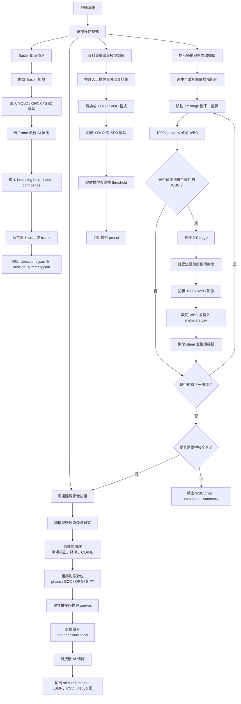
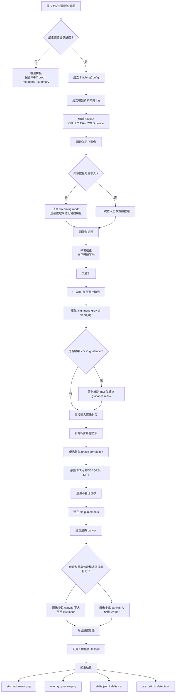
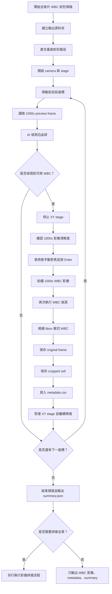
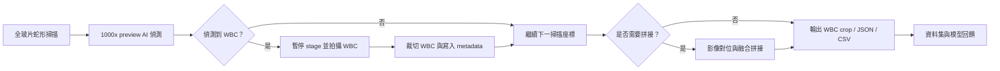
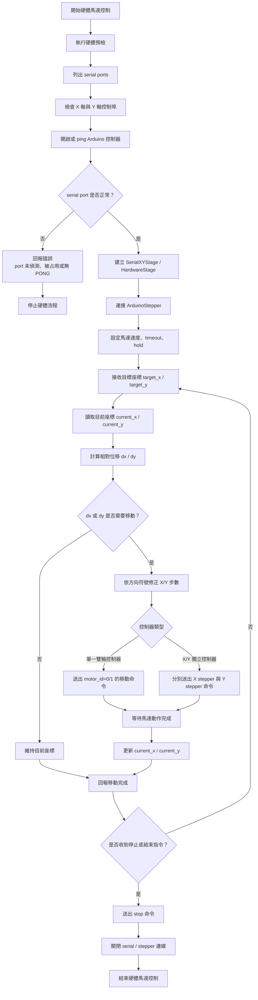
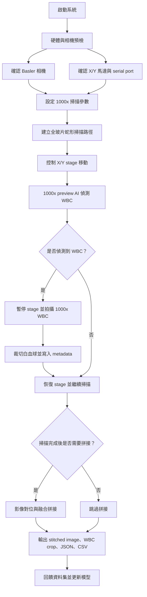

# 智慧化顯微鏡病理影像掃描與 AI 輔助分析系統 - 流程圖

用途：期末成果報告、簡報、專題展示  
格式：Mermaid，可直接貼到支援 Mermaid 的 Markdown、Notion、HackMD、GitHub 或簡報工具中使用。

## 1. 系統整體流程圖

## 2. 影像拼接可選流程圖

## 3. 白血球蛇形掃描擷取流程圖

## 4. 報告用短版流程圖

如果報告版面有限，可以使用此版本：

## 5. 硬體 X/Y 馬達控制流程圖

## 6. 簡化版全部過程流程圖

適合放在報告前段或簡報摘要頁，讓讀者先快速理解整個系統以全玻片掃描與白血球擷取為主，影像拼接則依需求作為可選分支。

